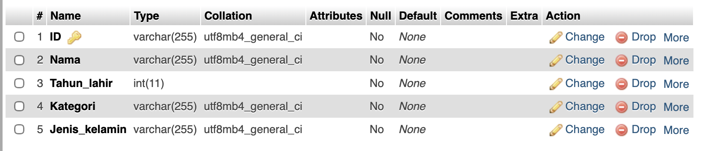

# Janji
Saya Muhammad Dzaka Indrianto dengan NIM 2508755 mengerjakan Tugas Praktikum 5 dalam mata kuliah Desain dan Pemrograman Berorientasi Objek untuk keberkahanNya maka saya tidak melakukan kecurangan seperti yang telah dispesifikasikan. Aamiin.

# Desain Program

# Penjelasan alur
alasan saya memilih desain seperti ini karena id menurut saya superkey daninputnya bisa angka dan huruf, lalu alasan saya mendesain seperti ini karena menurut saya ini udah meliputi hal hal yang sewajarnya dimiliki karyawan, nama, tahun lahir, kategori status kerja, sama jenis kelamin, disini saya jenis kelamin cuma laki sama perempuan soalnya yang lainnya belom umum kayanya di indo, sisa penjelasannya masih sama kaya tp4.  
untuk penjelasan struktur for saya disini saya menggunakan Jlabel untuk menamai judul data karyawan, saya juga menggunakan Jlabel untuk penamaan lain seperti melabelkan kegunnan input box di seblah kiri form yaitu box id, nama,dll. 

selanjutnya saya menggunakan JTextField untuk input id, nama, dan tahun lahir, dan biar dapet bonus saya pake jComboBox buat status kategori karyawan sama pake jRadioButton buat jenis kelamin(disini saya pake 2 buat laki laki sama perempuan saya belum nambahin buat yang diluar itu). 

Terus ada 4 JButton di kanan buat Input, update, delete, dan cancel, nah cancel ini buat apasi bang? cancel ini buat ngosongin si box boxnya ketika lu gajadi melakukan sesuatu yak. 

terus dibawah saya pake Jscrollpane buat tempat buat Jtabel buat data data yang udah dan akan diinput, saya juga ada data yang di hardcode
 
terus itu tabel template blom diuba jadi kaya yang di form maaf.

# Dokumentasi

ini query tabel aku buatnya ga diterminal ini di phpmyadmin 
 
ini data awal yang tadi aku bilang, aku input ke db 
 
ini smua dokumentasi di youtube 
https://youtu.be/_fCN1exA_1c?si=qWaXsg5R61i5_U7J](https://youtu.be/_fCN1exA_1c?si=AVhwLzaIUE8oVGSd
